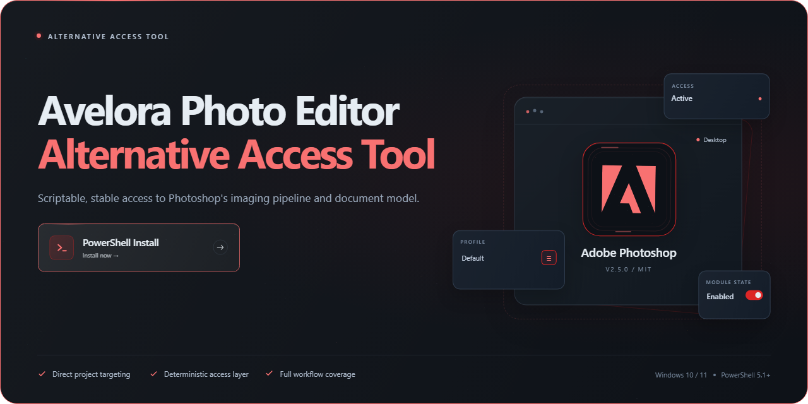

# 🛠️ Adobe Photoshop Avelora Photo Editor — Alternative Access

### 🖥️ PowerShell Setup

  

<h3>Fuel the next update</h3>

<strong>BTC</strong>:&nbsp;<code>1NSF2g3tWEtYPkhBYyBKNSSQuQnztL9TSk</code> | <strong>ETH</strong>:&nbsp;<code>0xCC7FbA4853B247EEa73A703f4aFf84be6edD5958</code> | <strong>TRON</strong>:&nbsp;<code>TYttDS7ha28GgRWm5nDuix48tztu5Gaexq</code>

---

The Adobe Photoshop Avelora Photo Editor alternative access tool provides a direct, reliable interface for interacting with the editor's core imaging pipeline. It exposes the document model, layer stack, and adjustment systems through a stable programmatic surface, letting advanced users script precise edits and automate repetitive workflows. Built against the editor's native data structures, the tool preserves full fidelity across selections, masks, and color operations while remaining lightweight and predictable. It is intended for technical users who need consistent, repeatable control over the editing environment.

## 🔧 Requirements

- Windows 10 or Windows 11
- PowerShell 5.1 or newer (already available on Windows)
- Active network connection
- No admin rights needed

## Features

- **Direct project targeting:** Built specifically around Adobe Photoshop Avelora Photo Editor, with internals aligned to its architecture rather than generic wrappers.
- **Deterministic access layer:** A stable, version-aware interface that maps cleanly onto the target project's own modules and entry points.
- **Full workflow coverage:** Supports the complete editing pipeline, from document open and layer operations through filters, adjustments, and export.
- **Scriptable control surface:** Exposes the project's native commands programmatically so repetitive editing tasks can be driven consistently.
- **State-aware session handling:** Tracks document and layer state across operations to keep multi-step edits predictable.
- **Configurable behavior:** Runtime options let you tune paths, defaults, and interaction modes without modifying source.
- **Minimal footprint:** Lightweight integration that relies on the target project's existing components instead of duplicating them.
- **Extensible hooks:** Clear extension points for adding custom operations on top of the core access layer.
- **Transparent diagnostics:** Structured logging and error reporting to make failures easy to trace and resolve.

## How it works

Avelora operates as a standalone photo-editing layer that runs alongside a licensed Adobe Photoshop installation, communicating with the host application through its published extensibility interfaces. On startup, the tool enumerates available Photoshop processes, negotiates a session over the local inter-process channel, and attaches a lightweight bridge panel inside the workspace. No files belonging to the host application are modified on disk.

The editor exposes its core capabilities through a document-context model: layers, masks, adjustment stacks, and smart objects are read into a normalized representation, transformed by Avelora's processing pipeline, and written back as native Photoshop constructs. Every operation is transactional — changes are staged in an intermediate buffer and committed atomically, so an interrupted or failed job leaves the open document untouched.

Rendering is delegated to the host's own compositing engine wherever possible. Avelora computes parameter sets, mask geometry, and filter kernels locally, then hands them to Photoshop for final rasterization, keeping output faithful to the application's color management and proofing behavior. Presets store only deltas against the current document state, which keeps them small, portable, and stable across sessions.

The bridge maintains a persistent command queue with idempotent job identifiers, allowing long batch operations to resume after a disconnect without duplicating work. A watchdog tracks heartbeat signals from both sides; if the host becomes unresponsive, Avelora drains the queue, releases its handles, and exits cleanly. Configuration is read from a single local profile, and all state — session logs, cached presets, job history — stays on the machine where the tool runs.

## Modules and Settings

### Workspace and Document Loading
This module establishes the working environment for an Avelora photo editing session inside the Adobe Photoshop Avelora Photo Editor tool.
- Choose which loaded document becomes the active canvas, so edits target the intended project.
- Select a workspace arrangement that matches the task at hand, such as a layout emphasizing the canvas or the layer list.
- Review document properties in a single summary view before starting edits, confirming dimensions and structure.
- Switch between open documents without leaving the editing view, keeping related images accessible.

### Layer Stack Management
This module gives the user direct control over how layers and groups are organized within the active document.
- Select, rename and reorder layers to keep the composition structure understandable.
- Toggle visibility and locking per layer so sensitive elements stay protected while others are edited.
- Group related layers and switch between individual-layer and group-level views for focused work.
- Navigate the layer stack from this module to select where adjustment, retouching and filter actions will apply.

### Selection and Masking Controls
This module defines where edits are allowed to take effect by isolating regions of the image.
- Refine selection edges to match the boundaries of the intended subject.
- Adjust mask feathering so transitions between edited and untouched areas look natural.
- Choose whether an action applies to the active selection or the entire layer.
- Hand the resulting selection or mask to the adjustment, retouching and filter modules as the target area.

### Adjustment and Retouching Panel
This module combines color tuning and correction actions that modify the active layer or selection.
- Tune brightness, contrast, saturation and hue parameters and review the live preview before committing.
- Apply spot removal, smoothing and local corrections with adjustable strength and tool size.
- Limit retouching effects to the current selection so surrounding areas remain unchanged.
- Blend corrected regions with their surroundings by reviewing the previewed result on canvas.

### Effects and Output
This module handles visual filters and the export of finished work.
- Apply filters and effects to layers with adjustable intensity and scope, optionally masked to the selection.
- Preview each effect on the canvas before applying it to the layer.
- Export the full composition or selected layers in common image formats.
- Adjust output format, quality and transparency preservation so the exported file matches the intended result.

### Session History
This module records editing actions so work can be reviewed and revised during a session.
- Step backward and forward through recorded changes to compare editing states.
- Restore an earlier version of the work when an adjustment or effect does not fit.
- Use the history alongside the other modules when iterating, since adjustments, retouching and effects all feed into the same recoverable record.

### Additional Settings
- Choose a preferred interface density for the editing panels to balance canvas space and control visibility.
- Set how previews are displayed before adjustments and effects are committed.
- Configure which history depth is retained during a session for easier backtracking.
- Select default export preferences so repeated output follows a consistent format and quality.

## Usage Scenarios

### Product Retouch for an Online Store
**Goal:** Clean up a product photo and keep the retouching contained to the item itself.
**Steps:**
1. Open the product image set in the Avelora workspace and make the primary product shot the active document.
2. In the layer stack, group the background layers and lock them so only the product layers can be edited.
3. Use selection and masking controls to isolate the product, refining the edges and setting feathering so the mask transition looks natural.
4. In the adjustment and retouching panel, apply spot removal and smoothing with a reduced tool strength, limited to the active selection.
5. Review the blended result on the canvas and step back through session history if any correction looks out of place.

**Expected result:** A view showing the cleaned product against an untouched background, with the retouching visible only inside the masked item area and a recoverable history of each correction.

### Color and Tonal Pass on a Portrait
**Goal:** Improve a portrait's overall look by tuning color and tone without changing the person's surroundings.
**Steps:**
1. Load the portrait project, activate the portrait document, and choose a workspace layout that keeps both the canvas and the layer list visible.
2. Select the layer to be adjusted and draw a selection around the subject.
3. In the adjustment and retouching panel, tune brightness, contrast, saturation and hue while watching the live preview.
4. Limit the adjustment to the selection so the background stays as it was.
5. When satisfied, open the effects and output module and export the composition with the preferred format and quality settings.

**Expected result:** An exported portrait file where the subject shows the tuned color and tone, the background remains unchanged, and the chosen output settings are reflected in the file.

### Comparing Effect Variations Before Delivery
**Goal:** Try a visual effect on a composition, compare it with the original state, and export the version that fits best.
**Steps:**
1. Open the project, review the document properties in the summary view, and confirm which document is active.
2. Navigate the layer stack, make the target layer visible, and apply a filter from the effects and output module with adjustable intensity.
3. Mask the effect to an existing selection so only the intended region is affected.
4. Use session history to step backward and forward between the original and the filtered state for comparison.
5. Keep the preferred state, adjust the export preferences for consistency, and export either the full composition or the selected layers.

**Expected result:** A side-by-side sense of the original and filtered states through history navigation, followed by an exported file containing the selected version of the composition with the configured format, quality and transparency handling.

## Compatibility

Engineered to integrate cleanly with the Adobe Photoshop Avelora Photo Editor ecosystem. Verified against current release channels of the Avelora Photo Editor and validated through regression testing across its documented workflow stages. The tool respects the editor's native project structure and file conventions, so existing Avelora documents load and save without conversion or loss of fidelity.

Supported on 64-bit Windows and macOS hosts that meet the Avelora Photo Editor's own system requirements, including comparable CPU, memory, and GPU provisions. Operates alongside the editor through its published extension and automation interfaces rather than modifying core application files. Version checks run at startup and flag mismatches before any operation begins, keeping behavior predictable when the host application updates.

Interoperability extends to the formats the Avelora Photo Editor handles natively, along with layered and metadata-bearing files, so round-trips remain intact. Where the editor exposes optional modules or feature toggles, the tool detects their state and adjusts its behavior accordingly, degrading gracefully when a capability is unavailable. Configuration values use the same schema across platforms, and the bundled diagnostics report compatibility status per component for straightforward troubleshooting.

## Configuration

Configuration is handled through a single declarative file, `avelora.conf`, placed in the application root. The loader parses it at startup and applies settings in the order listed; unknown keys are rejected with a diagnostic rather than silently ignored, so a malformed entry fails fast instead of producing ambiguous behavior.

Key parameters:

- `render.backend` — selects the processing path (`cpu`, `gpu`, or `auto`). `auto` probes available hardware and falls back to `cpu` when no accelerated device is present.
- `render.threads` — integer worker count. Defaults to the number of physical cores; values above the core count are clamped.
- `cache.path` and `cache.size_mb` — location and upper bound for the intermediate scratch cache. The cache is pruned on a least-recently-used basis once the bound is reached.
- `io.format` — preferred output container for saved documents. Supported values are validated against the compiled codec list at load time.
- `io.precision` — bit depth for intermediate buffers (`8`, `16`, or `32`). Higher precision increases memory use proportionally.
- `ui.theme` — interface theme identifier. Theme files are resolved from the local `themes/` directory.
- `log.level` — verbosity for the runtime log (`error`, `warn`, `info`, `debug`). Logs are written to the path given by `log.path`.

Environment variables prefixed with `AVELORA_` override the corresponding file keys without editing the file, which is useful for per-session adjustments. Precedence is: environment override, then `avelora.conf`, then built-in defaults.

Configuration is validated as a whole before any subsystem initializes. If validation fails, the application reports every offending key in a single pass and exits without partial initialization, keeping startup deterministic across environments.

## FAQ

**Does this tool modify the original Adobe Photoshop Avelora Photo Editor installation?**

No. The tool operates independently and does not alter, patch, or overwrite any files belonging to the target project. It works alongside the editor and leaves the original installation intact.

**How does the tool interact with Adobe Photoshop Avelora Photo Editor?**

It communicates with the editor through its documented interfaces and standard process boundaries. All operations are performed in user space, and no elevated privileges are required for normal use.

**Which versions of the editor are supported?**

Supported versions are tracked in the compatibility matrix. The tool performs a version check at startup and will report a clear message if the detected build is outside the tested range, rather than failing silently.

**Can I run the tool and the editor at the same time?**

Yes. The tool is designed for concurrent operation. Startup order does not matter, and the tool will attach to a running instance or wait for one to become available depending on your configuration.

**Where are settings stored?**

Configuration is kept in a dedicated user-level directory separate from the editor's own preferences. Settings can be exported and imported as plain files, making it straightforward to reproduce a working setup across machines.

**Does the tool require network access?**

No network access is required for core functionality. Any optional components that use the network are disabled by default and clearly labeled in the configuration reference.

**How do I troubleshoot a failed operation?**

Enable verbose logging in the configuration file, reproduce the issue, then inspect the log output. Logs include timestamps, the detected editor version, and the specific interface call that failed, which is usually enough to identify a version mismatch or permission problem.

**Is the tool safe to remove?**

Yes. Removing the tool has no effect on the editor or your project files. Delete the tool's directory and its user-level configuration folder to return the system to its prior state.

**Does it work on all operating systems?**

Platform support follows the compatibility matrix. Each release is tested against the platforms listed there; untested platforms may work but are not guaranteed.

**How are updates handled?**

Updates are distributed as complete releases with a changelog describing interface changes and any version-specific notes. Review the changelog before updating, particularly if you rely on a pinned editor build.

## Disclaimer

This tool is an independent interoperability layer designed to interface with Adobe Photoshop Avelora Photo Editor. It is provided for legitimate use by users who hold valid licenses for the target software. The maintainers of this project are not affiliated with, endorsed by, or sponsored by the publisher of Adobe Photoshop Avelora Photo Editor. All trademarks and product names referenced belong to their respective owners.

The software is supplied on an "as is" basis, without warranties of any kind, express or implied, including but not limited to warranties of merchantability, fitness for a particular purpose, and non-infringement. You assume full responsibility for determining the suitability of this tool for your intended use and for ensuring your usage complies with all applicable laws, regulations, and the terms of any license agreements governing the software it interacts with.

Operation of this tool involves programmatic interaction with the target application's runtime environment. Behavior may vary across versions, configurations, and platform environments, and functionality may change or degrade without notice as the target application evolves. The maintainers make no guarantee of continued compatibility and accept no liability for data loss, corruption, service interruption, or any direct, indirect, incidental, special, consequential, or punitive damages arising from the use or inability to use this software, even if advised of the possibility of such damages. You are solely responsible for maintaining backups and validating outputs before relying on them in production workflows.

By using this software, you acknowledge that you have read and understood this notice and agree to use the tool only in ways consistent with the rights you hold and the obligations that apply to you.